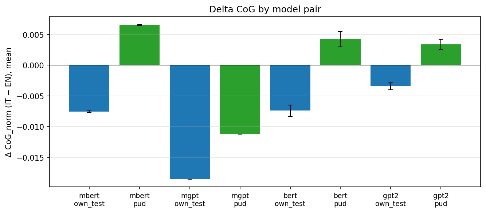

# WS3 cross-linguistic results: Delta CoG

## Definition

**Center of Gravity (CoG)** is the selectivity-weighted mean layer (layers 1…L), divided by L for **CoG_norm** (relative depth τ ∈ [0, 1]). **Selectivity** at each layer is UPOS accuracy minus control accuracy.

**Delta CoG** = CoG_norm(IT) − CoG_norm(EN). A positive value means UPOS information peaks relatively deeper in Italian than in English (PROPOSAL.md, workstream 3).

Linear probe settings: **pretrained** init, **first** subword pooling, task **upos**, `max_train_rows = 50_000`. For **mbert**, **bert**, **bert_it**, **gpt2** and **geppetto**, three train-sample seeds **42, 43, 44** were run (the linear probe is deterministic; only the 50k-row subsample changes). **mGPT** is reported at seed **42** only: train rows are already below the cap (`n_train` ≈ 49,986 / 49,992), so other seeds would repeat the same run.

## Delta CoG table (linear probe, mean ± std over seeds)

| pair | kind | eval_set | cog_norm_en | cog_norm_it | delta_cog_mean | delta_cog_std | n_seeds |
| --- | --- | --- | ---: | ---: | ---: | ---: | ---: |
| mbert | multilingual | own_test | 0.6086 | 0.6010 | −0.0076 | 0.0001 | 3 |
| mbert | multilingual | pud | 0.5903 | 0.5968 | +0.0066 | 0.0001 | 3 |
| mgpt | multilingual | own_test | 0.5839 | 0.5654 | −0.0186 | — | 1 |
| mgpt | multilingual | pud | 0.5736 | 0.5623 | −0.0112 | — | 1 |
| bert | paired | own_test | 0.5971 | 0.5897 | −0.0074 | 0.0009 | 3 |
| bert | paired | pud | 0.5797 | 0.5840 | +0.0042 | 0.0012 | 3 |
| gpt2 | paired | own_test | 0.5941 | 0.5906 | −0.0034 | 0.0006 | 3 |
| gpt2 | paired | pud | 0.5813 | 0.5847 | +0.0034 | 0.0008 | 3 |

Per-seed values are in `results/summary/delta_cog_by_seed.parquet`. **mBERT MLP** (robustness, seed 42 only): own_test Δ = −0.0235; PUD Δ = +0.0021.

Generated with:

```bash
PYTHONPATH=src python scripts/40_crossling_report.py
```

## Figures




## Answer to the research question

We do **not** see a consistent “Italian peaks later” pattern. For the four comparisons with three seeds, **|delta_cog_mean| is much larger than delta_cog_std** (typically 0.003–0.008 vs 0.0001–0.001), and the **sign is stable across seeds** within each eval set. So the small effects are repeatable under train resampling, not noise from a single sample.

Magnitudes stay within about **±0.02**. Signs still **flip between own-treebank test and PUD**: on own test, all three multi-seed pairs are **negative** (English CoG_norm slightly higher); on PUD, all three are **positive**. **mGPT** (seed 42) is negative on both eval sets and shows the largest single-seed gap on own test (−0.019).

Paired monolinguals track each other closely; Delta CoG does not support a large or systematic cross-lingual depth shift between matched architectures.

## Caveats

- Multi-seed spread reflects **train subsampling only** (linear `lbfgs` probe, fixed control mapping with seed 42). It does **not** cover pretraining or feature-extraction variability.
- **mGPT** excluded from multi-seed runs for the reason above.
- Italian rows include more **multiword-token (MWT) parts** (~13.3% of ISDT rows) than English (~2.6% EWT, ~1.2% PUD EN); see [ws3_italian_notes.md](ws3_italian_notes.md).
- English **bert** / **gpt2** baselines share the same feature revision as the Italian runs where applicable (`HLT_HF_REVISION=723fde00…`).

## Reproducibility

| Artifact | Path |
| --- | --- |
| Code | `src/ws3_crossling/delta_cog.py`, `src/viz/crossling_plots.py`, `scripts/40_crossling_report.py` |
| Probing (3 seeds) | `results/probing_seeds/seed{42,43,44}/` merged into `results/probing/` for the six linear jobs |
| Summary input | `results/summary/cog.parquet` |
| Delta tables | `results/summary/delta_cog.parquet`, `delta_cog_by_seed.parquet` |
| Figures (contract) | `results/figures/ws3/*.png` |
| Tests | `tests/test_delta_cog.py` |

Large parquet outputs are on Hugging Face `hlt-group11/features` under `results/x5_crossling/` (not committed to Git).