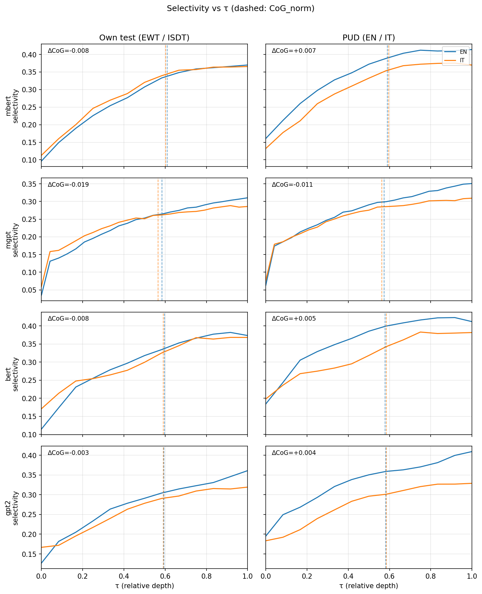

# WS3 cross-linguistic results: Delta CoG

## Definition

**Center of Gravity (CoG)** is the selectivity-weighted mean layer (layers 1…L), divided by L for **CoG_norm** (relative depth τ ∈ [0, 1]). **Selectivity** at each layer is UPOS accuracy minus control accuracy.

**Delta CoG** = CoG_norm(IT) − CoG_norm(EN). A positive value means UPOS information peaks relatively deeper in Italian than in English (PROPOSAL.md, workstream 3).

All numbers below use a **linear** probe, **pretrained** init, **first** subword pooling, task **upos**, **seed 42**, and `max_train_rows = 50_000`.

## Delta CoG table (linear probe)

| pair | kind | eval_set | cog_norm_en | cog_norm_it | delta_cog |
| --- | --- | --- | ---: | ---: | ---: |
| mbert | multilingual | own_test | 0.6092 | 0.6015 | −0.0077 |
| mbert | multilingual | pud | 0.5903 | 0.5968 | +0.0065 |
| mgpt | multilingual | own_test | 0.5839 | 0.5654 | −0.0186 |
| mgpt | multilingual | pud | 0.5736 | 0.5623 | −0.0112 |
| bert | paired | own_test | 0.5977 | 0.5901 | −0.0076 |
| bert | paired | pud | 0.5795 | 0.5850 | +0.0055 |
| gpt2 | paired | own_test | 0.5943 | 0.5915 | −0.0028 |
| gpt2 | paired | pud | 0.5811 | 0.5850 | +0.0038 |

**mBERT MLP** (robustness check only): own_test Δ = −0.0235; PUD Δ = +0.0021.

Generated with:

```bash
PYTHONPATH=src python scripts/40_crossling_report.py
```

## Figures




## Answer to the research question

We do **not** see a consistent “Italian peaks later” pattern. Delta CoG stays within about **±0.02** for every comparison. Signs **flip between own-treebank test and PUD**: on own test (EWT vs ISDT), all four linear-probe deltas are **negative** (English CoG_norm is slightly higher); on PUD, three of four are **positive** (Italian slightly higher), with **mGPT** negative on both eval sets.

The multilingual decoder (**mGPT**) shows the largest shift on own test (−0.019), but still small in absolute terms. Paired monolinguals (**BERT / Italian BERT**, **GPT-2 / GePpeTto**) track each other closely; Delta CoG does not support a systematic cross-lingual depth gap between matched architectures.

## Caveats

- **Single seed (42)** and **linear probe only**; optional multi-seed spread (issue #31 step 2) was not run.
- Italian rows include more **multiword-token (MWT) parts** (~13.3% of ISDT rows) than English (~2.6% EWT, ~1.2% PUD EN); see [ws3_italian_notes.md](ws3_italian_notes.md). Comparisons use the same UD-word contract on both sides but alignment noise may differ.
- English **bert** / **gpt2** baselines come from workstream 1 (#12); Italian and multilingual runs from X2–X4 on the same feature revision where applicable.

## Reproducibility

| Artifact | Path |
| --- | --- |
| Code | `src/ws3_crossling/delta_cog.py`, `src/viz/crossling_plots.py`, `scripts/40_crossling_report.py` |
| Summary input | `results/summary/cog.parquet` (from `scripts/11_summarize_probing.py`) |
| Delta table | `results/summary/delta_cog.parquet` |
| Figures (contract) | `results/figures/ws3/*.png` |
| Tests | `tests/test_delta_cog.py` |

Large parquet outputs are on Hugging Face `hlt-group11/features` under `results/x5_crossling/` (not committed to Git).